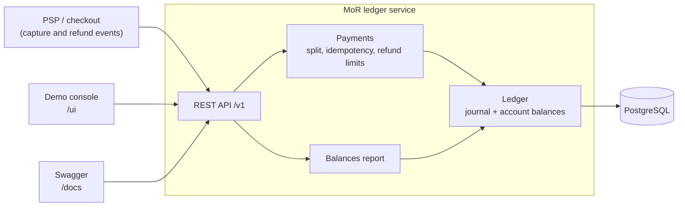

# Mini MoR Ledger Service

[](https://github.com/refined/outpost/actions/workflows/ci.yml)

## What it is and why

A **Merchant of Record (MoR)** sells a merchant's product in its own name. It:
- collects the payment from the customer;
- is liable for the sales tax/VAT;
- keeps its fee;
- owes the rest to the merchant.

Every payment is split between three parties, and refunds and retried webhooks make it easy to lose or double-count a cent.

This service is the MoR's **ledger**: the source of truth for who is owed what. It can:

- **record captured payments**: split each one into tax, the MoR fee and the merchant's share;
- **record refunds**, full or partial, and reverse exactly the right amounts;
- **report balances**:
  - how much the MoR owes each tax authority;
  - what each merchant's balance with the MoR is, now or as of any past date;
- **handle several currencies**, each kept separately;
- **show it all** in a small web console.

## How it works



There are three ways in:

- **REST API** (`/v1`): what a payment provider's webhooks or a checkout would call.
- **Demo console** (`/ui/`): capture and refund payments by hand, or run a scripted scenario, and watch the report and the journal update.
- **Swagger** (`/docs/`): the interactive API spec.

### The API

The three operations the service exists for. Money is in integer **minor units** (cents); rates are decimal strings.

**Capture a payment**: `POST /v1/payments`

```json
{"paymentId": "pay_1001", "merchantId": "acme", "amount": 12100, "currency": "EUR",
 "taxRate": "0.21", "taxJurisdiction": "NL"}
```

The response returns the split: `taxAmount: 2100`, `feeAmount: 605`, `merchantAmount: 9395`.

**Refund a payment**: `POST /v1/payments/{paymentId}/refunds`

```json
{"refundId": "ref_1001_a", "amount": 6050}
```

Omit `amount` for a full refund. A refund larger than what remains is rejected (`422`).

**Balances report**: `GET /v1/reports/balances` (optionally `?asOf=2026-10-01T00:00:00Z`)

```json
{
  "taxAuthorities": [{"jurisdiction": "NL", "currency": "EUR", "amountOwed": 1050}],
  "merchants":      [{"merchantId": "acme", "currency": "EUR", "balance": 4395}],
  "mor":            [{"currency": "EUR", "feeRevenue": 605, "pspClearing": 6050}],
  "integrity":      {"balanced": true, "unbalancedCurrencies": []}
}
```

`paymentId` and `refundId` are the external event ids, so a retried event is safe: the same request returns the stored result (`200`), and the same id with different data is rejected (`409`). Errors look like `{"error": "<code>", "message": "..."}`. The read-only helper endpoints used by the console are listed in Swagger.

## How the ledger works

The ledger is **double-entry**: every event is one journal entry whose debits equal its credits.

### Accounts

There are four kinds of account, one set per currency:

| Account | Holds |
|---|---|
| `psp_clearing` | Money collected from customers (held at the payment provider) |
| `tax_payable:{country}` | Tax owed to that country's authority |
| `merchant_payable:{merchant}` | What the MoR owes the merchant |
| `fee_revenue` | The MoR's fee |

### Capture

The capture carries what the customer paid, **tax included**, and the tax rate. It becomes one balanced entry:

```
Customer paid €121.00 in NL, VAT 21%, MoR fee 5%

  Dr psp_clearing             121.00
  Cr tax_payable:NL                     21.00   = 121.00 × 0.21 / 1.21
  Cr fee_revenue                         6.05   = 5% of 121.00
  Cr merchant_payable:acme              93.95   = the rest
```

- **Rounding.** Tax and fee are rounded half-up to the cent; the merchant gets the exact remainder, so the entry always balances.
- **Snapshot.** The fee rate and the refund policy are stored on the payment, so changing the config later does not touch past sales.

### Refund

A refund is the mirror entry for the refunded part.

- **Partial refunds.** A partial refund is split across tax, fee and merchant in proportion to what is still refundable of each. The refund that empties the payment takes exactly what is left, so a series of partial refunds never drifts by a cent. A property test checks this over 10,000 random sequences.
- **The fee.** By default **the MoR keeps its fee** (`REFUND_FEE_POLICY=MOR_KEEPS_FEE`), like most payment providers. After a full refund, the merchant's balance is **−€6.05**: the merchant owes the MoR its fee. With `MOR_RETURNS_FEE`, everything goes back to zero.

### Balances

- **Stored balance.** Each account stores its current balance. The balance changes **in the same database transaction** as the journal entry, with an atomic `UPDATE … SET balance = balance + x`. The report simply reads these balances.
- **Report as of a date.** A report "as of" a past date sums the journal entries up to that date instead.

### Correctness under load

- **Concurrency.** Concurrent payments touching the same account queue up on the database row lock, so nothing is lost and no extra locking code is needed. Refunds of one payment are serialised by locking the payment, so they can never exceed the captured amount.
- **Invariants enforced by the database itself.**
  - Every journal entry must balance (checked at commit).
  - History is append-only: no `UPDATE` or `DELETE`.
  - The parts of every payment must add up to its amount.

## Installation and configuration

Only **Docker** is needed:

```bash
docker compose up -d --build --wait              # build and start Postgres + the service
docker compose --profile test run --rm test      # run the test suite in a container
docker compose --profile test down               # stop everything
```

| URL | |
|---|---|
| http://localhost:8090/ui/ | Demo console |
| http://localhost:8090/docs/ | Swagger UI |
| [docs/demo.http](docs/demo.http) | The demo scenario as HTTP requests |

Ports, database credentials, the fee rate and the refund policy can be changed in an optional `.env`. Start from [.env.example](.env.example); without a `.env`, the defaults apply.

## Assumptions

- The capture carries the **tax-inclusive** amount the customer paid, plus the tax rate and the tax jurisdiction.
- The MoR fee is a flat **% of the gross** amount (5% by default).
- The MoR **keeps its fee on refunds** by default; this is configurable.
- A merchant's balance **may go negative**. Recovering it belongs to payouts.
- **Multi-currency without FX**: balances are kept and reported per currency.
- Out of scope: payouts, settlement, tax remittance, chargebacks, invoicing, authentication.

Every decision with its reasoning: [docs/design.md](docs/design.md#assumptions).

## Key trade-offs

- **Own ledger on Postgres instead of TigerBeetle or Formance.** The payment and its journal entry commit in one transaction. An external ledger would turn every payment into a write to two systems that can disagree. The ledger engine is a small module that knows nothing about payments, so it can be replaced.
- **Balances stored and updated synchronously, not recomputed on every read or fed from a queue.**
  - Reads are instant and always exact.
  - The cost is a short lock on the shared accounts (`fee_revenue`, `psp_clearing`) per payment. That is fine at this scale; beyond it: sub-accounts, batching, or TigerBeetle.
- **Event ids as idempotency keys**, matching how payment-provider webhooks are retried.

More, including concurrency alternatives, time handling, and what each out-of-scope feature would add: [docs/design.md](docs/design.md#trade-offs).

## More

- [docs/requirements.md](docs/requirements.md): what we set out to build.
- [docs/design.md](docs/design.md): all decisions and trade-offs, tests, CI, configuration, code layout.
- [docs/domain/](docs/domain/): background on the MoR model and EU VAT.
- [AGENTS.md](AGENTS.md): working notes for contributors and AI agents.
