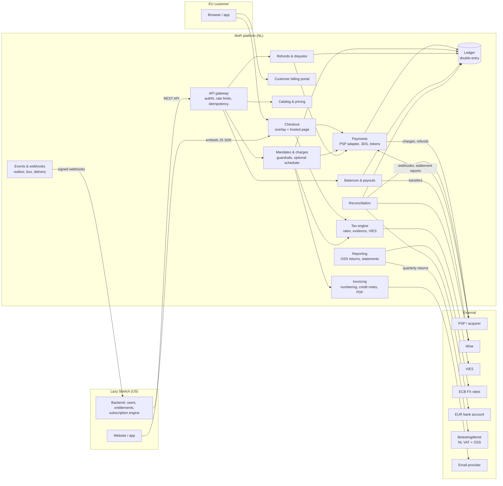
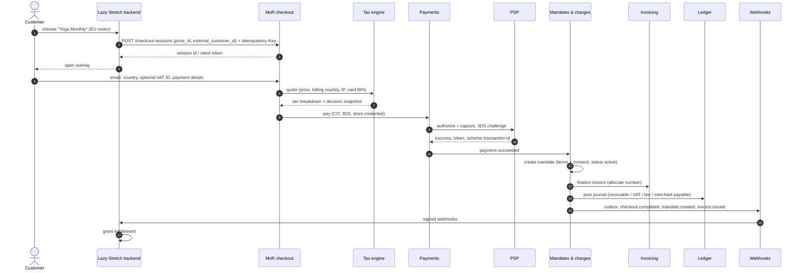
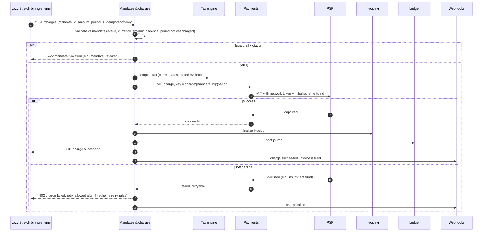

# MoR Design Options & Trade-offs

> The main design forks for an EU Merchant of Record platform, with options and the chosen leaning for each. Context: [mor-context.md](mor-context.md).

## Overview

| # | Decision | Options | Leaning |
|---|---|---|---|
| D1 | Who owns the subscription lifecycle | A: MoR billing engine · B: unguarded merchant charges · C: we run renewals · D: mandate-guarded merchant charges | **One mandate model; C (script + webhook, we run renewals) as default, D (server API) as optional mode** (simplest merchant integration wins) |
| D2 | Checkout integration surface | Hosted page · overlay/JS SDK · headless API · payment links · orchestrator connector | **Overlay + hosted fallback** |
| D3 | Tax engine | Build · buy · hybrid | **Hybrid** |
| D4 | Pricing and currency | Tax-inclusive vs exclusive; price points vs auto-FX | **Tax-inclusive price points per currency** |
| D5 | Ledger, balances, payouts, FX | Balance column vs double-entry ledger; EUR vs USD balances; payout cadence | **Double-entry ledger, EUR balances, convert at payout** |
| D6 | Invoicing mechanics | When to issue, numbering strategy, rendering | **Issue on payment, gapless per series, data-first** |
| D7 | Existing EU subscribers | Grandfather · token import · opt-in re-checkout | **New via MoR; existing via re-consent** |
| D8 | Architecture style | Modular monolith · microservices · hybrid | **Consistent money core + async satellites** |
| D9 | PSP strategy | Single PSP · multi-PSP orchestration; pooled vs dedicated merchant accounts | **Single PSP behind a port; dedicated merchant account (MID) per merchant** |
| D10 | Merchant sync | Webhooks only · polling · both | **Webhooks + events API for replay** |
| D11 | Build vs buy | Stripe Billing/Tax/Connect · Wise · own core | **Own the liability-bearing core, buy commodities** |

---

## D1. Who owns the subscription lifecycle?

**The tension.** The merchant "already manages users' subscriptions" and wants to offload compliance and payments, not rebuild its billing. Outpost's own positioning is "no migration required" and "subscription billing is optional". But we are the legal seller. We must be able to prove the customer agreed to each charge, honour cancellation and withdrawal rights and price-change notices, and run SCA-compliant recurring payments. This is the key architectural decision.

### Option A — Full billing MoR ("Paddle Billing" style)

We own the catalog, plans, subscription state machine, renewals, proration, dunning and the customer UI for plan changes. The merchant's system becomes a projection of our webhooks.

- ➕ Full control; renewals don't depend on the merchant.
- ➖ Forces the merchant to migrate its billing. That contradicts the merchant's situation ("already manages subscriptions") and Outpost's "no migration" pitch.

### Option B — Unguarded merchant-driven charges ("raw headless")

The merchant calls `POST /charges` with a stored payment method whenever it likes. We only do tax, payment, invoice and ledger.

- ➕ Zero disruption.
- ➖ We are the seller but can't prove consent for *this* amount at *this* time.
- ➖ Forgotten cancellations and surprise price hikes become our problem, and the resulting disputes land on **our** card-network ratios.
- **Rejected.**

### Option C — We run renewals (agreement-based, platform-scheduled)

We own the billing agreement *and* execute renewals and dunning with our scheduler. The merchant commands changes via the API and mirrors state from webhooks.

- ➕ Reliable renewals; maximum compliance control.
- ➖ The merchant has to move renewal logic to us: a partial migration.

### Option D — Mandate-guarded, merchant-triggered charges

The merchant's billing engine stays the source of truth for plans and timing and triggers each renewal via our API. We own the **mandate**: the customer's consent, captured in *our* checkout, covering amount, currency, interval and seller identity. We **validate every charge against it**.

- ➕ No migration; fits the merchant's situation and Outpost's model.
- ➕ Compliance is still enforced by the legal seller.
- ➖ Renewal timing depends on the merchant's cron. That is their revenue risk, not a compliance risk.
- ➖ Guardrail rules need careful design.

**Mandate guardrails (Option D):**

- **Creation.** A mandate is created only through a customer-present checkout (CIT + SCA) with explicit consent to the terms.
- **Validation on each merchant-triggered charge:**
  - The mandate is `active`.
  - The currency matches.
  - The amount is ≤ the agreed amount (or equals the amended amount after its effective date).
  - The cadence fits the interval: at most one charge per period, plus tolerance.
  - The period hasn't been charged yet (idempotency on `mandate + period`).
- **Price increase.** Goes through a `mandate amendment`. We notify the customer with advance notice; the new amount is allowed only after the effective date; the customer can cancel in between.
- **Cancellation.** The customer can always cancel in *our* portal (a legal requirement, e.g. the DE cancel button). The mandate is revoked, a webhook goes to the merchant, and further charges are rejected with `mandate_revoked`.
- **Retries.** Retries on declined charges are capped and spaced per card-network retry rules; we enforce this, not the merchant.
- **One-off purchases** (e.g. a paid workshop) need a new customer-present checkout or explicit one-off consent.

| Criterion | A | B | C | D |
|---|---|---|---|---|
| Merchant migration effort | High | None | Medium | **Low** |
| Consent and consumer-law control | Full | None | Full | **Full (enforced at charge time)** |
| Renewal reliability | Ours | Merchant's | Ours | Merchant's |
| Merchant flexibility | Low | High | Medium | **High** |
| Dispute risk on our ratios | Low | High | Low | **Low–Medium** |
| Fit with Outpost's product ("no migration") | Poor | Good, but unsafe | Partial | **Good** |

### Leaning

**One core model, the mandate, with two renewal modes:**

1. **Platform-scheduled (C).** The default and the MVP.
   - The merchant integrates with one script (local price + checkout iframe) and one webhook endpoint.
   - Everything else (refunds, invoices, payouts, reports) lives in the dashboard.
   - The merchant's subscription system only mirrors our status for EU customers.
   - Chosen because the merchant wants to sell in the EU "without worrying" about payments and compliance, so integration effort is the dominant criterion.
2. **Merchant-triggered (D).** An optional server API (V2) for merchants whose billing engine must stay in charge. It reuses the same mandate, charge, tax, invoice and ledger pipeline; only the trigger differs.

The key idea: **one domain model, pluggable triggers**. It also answers "what if the merchant has no billing system?" without a second architecture.

---

## D2. Checkout integration surface

| Option | How it works | ➕ | ➖ |
|---|---|---|---|
| 1. Hosted page (redirect) | The merchant redirects to `checkout.mor.example/...` | Simplest; zero PCI scope for the merchant; full control of legal disclosures | Context switch for the customer; lower conversion |
| 2. **Overlay / inline JS SDK** | The merchant embeds our JS, which opens our iframe | Good UX; still our page (disclosures, tax, withdrawal waiver) | JS SDK to maintain; iframe quirks |
| 3. Headless API + PSP hosted fields | The merchant builds the UI and calls our API | Maximum merchant flexibility | We lose control over seller identity, T&Cs, tax display and consent capture, which is a compliance risk |
| 4. Payment links | No-code links | Zero integration | Not suitable for an app with user accounts |
| 5. Orchestrator connector (Primer, Solidgate, ProcessOut…) | We appear as an extra payment route in the merchant's existing orchestration (Outpost's real-world pattern) | No change to the merchant's checkout or stack | Disclosures and consent must be rendered by the orchestrator's UI under our rules; depends on a partner integration |

**Leaning:** option 2 as the primary, option 1 as the fallback (mobile webviews, no-JS). Option 3 only for vetted merchants, with mandatory UI components. Option 5 is the future "no migration" channel; out of scope for the first iteration, since we have our own PSP account.

**Why:** as the legal seller we must show who is selling, the T&Cs, the VAT breakdown and the withdrawal-right consent. Controlling the checkout *is* compliance.

---

## D3. Tax engine: build vs buy

| Option | ➕ | ➖ |
|---|---|---|
| Build in-house | Full control, no per-transaction fee, EU rules are finite (27 countries) | Rate and rule maintenance; expansion to GST and US sales tax is expensive |
| Buy (Avalara, Vertex, Stripe Tax, Fonoa…) | Maintained content, broad coverage | Vendor latency and availability on the checkout path, cost per call, less control and auditability |
| **Hybrid** | We own the *tax decision domain*: jurisdiction, evidence, B2B/B2C, tax category mapping, rounding, audit snapshot. Rates and rules come from a pluggable provider or our own effective-dated table | More moving parts, but vendor-independent |

**Must-haves, whatever we choose:**

- Effective-dated rates.
- Deterministic rounding (per line, half-up; documented).
- A **tax decision snapshot** persisted per transaction: inputs, evidence, rule and rate version, result.
- Fallback to a locally cached rate table if the provider is down. EU rates are small and slow-changing.

---

## D4. Pricing and currency

**Tax-inclusive vs tax-exclusive.** EU consumers expect tax-inclusive prices. The flip side: with an inclusive price, the merchant's net depends on the country.

| Customer country | VAT rate | Price shown | Net to split | VAT |
|---|---|---|---|---|
| Luxembourg | 17% | €9.99 | €8.54 | €1.45 |
| Germany | 19% | €9.99 | €8.39 | €1.60 |
| Netherlands | 21% | €9.99 | €8.26 | €1.73 |
| Hungary (if charged in EUR) | 27% | €9.99 | €7.87 | €2.12 |

**Currency options:**

- Merchant-defined price points per currency: EUR plus PLN, SEK, DKK, CZK, HUF, RON.
- Automatic FX conversion from a base price.
- EUR only.

EUR already covers 21 of 27 member states.

**Leaning:** tax-inclusive price points per currency, with a fallback to EUR. B2B customers see the net price plus a reverse-charge note. Prices are stored as integer minor units plus a currency code, never as floats.

---

## D5. Money movement, ledger and payouts

**Ledger:** a **double-entry, append-only ledger**, not a mutable `balance` column. Every business event is posted as a balanced journal entry. Balances are derived (and can be cached or snapshotted).

**Worked example.** An NL consumer pays €12.10 (net €10.00 + 21% VAT €2.10). Our fee is 5% + €0.50 = €1.11. The PSP fee is €0.25.

| Event | Debit | Credit | Amount |
|---|---|---|---|
| Payment captured | PSP receivable | VAT payable (NL) | 2.10 |
| | | Platform fee revenue | 1.11 |
| | | Merchant payable: Lazy Stretch | 8.89 |
| PSP settles | Bank EUR 11.85 + PSP fee expense 0.25 | PSP receivable | 12.10 |
| Payout run | Merchant payable: Lazy Stretch | Bank EUR (via Wise) | 8.89 |
| Refund (full) | VAT payable 2.10 + merchant payable 8.89 + fee revenue 1.11 (policy!) | PSP receivable / Bank | 12.10 |

**Choices to make:**

- **Balance currency.**
  - EUR (the settlement currency), converted at payout: the merchant bears the FX risk, which is simple and transparent.
  - USD at transaction time: we bear the FX risk.
  - **Leaning: EUR.**
- **Pending vs available.** Only **settled** funds become available for payout.
- **Cadence.** Monthly or bi-weekly for this merchant; configurable per merchant.
- **Reserve.** A rolling reserve (e.g. X% for 90 days) or a fixed minimum balance, to cover refunds and chargebacks after payout.
- **Negative balances.** Refunds or disputes after a payout can push a balance negative. Offset against future payouts; if needed, debit the reserve or invoice the merchant.
- **Rails: Wise.** Flow: quote → recipient → transfer → fund. Idempotent via `customerTransactionId`; batch payouts; status via webhooks. The payout itself is a state machine: `scheduled → approved → submitted → paid | failed | returned`.

---

## D6. Invoicing mechanics

**When to issue:**
- **On successful payment** (recommended for B2C).
- Alternatively, at period start for B2B "pay by invoice".
- Failed payments produce no invoice.

**Numbering:** unbroken sequence per series.
- One global sequence is simple but creates a contention point.
- **Leaning:** series per legal entity, per document type (invoice / credit note), per year, e.g. `INV-2026-000123`. Allocate the number inside the finalisation DB transaction (row lock on an `invoice_series` counter). Drafts carry no number.
- If throughput ever demands it, several parallel series are legal as long as each one is sequential.

**Rendering:** data-first.
- The structured invoice record is the legal source.
- The PDF is rendered asynchronously from an immutable snapshot, stored in WORM object storage, and its hash is recorded.

**Refunds:** issued as credit notes that reference the original invoice. Partial refunds reduce VAT proportionally, and the correction lands in the OSS period in which it happened.

**Merchant side:**
- A monthly statement.
- Optionally a self-billed invoice for the merchant's supply to us (NL reverse charge).

---

## D7. Existing EU subscribers

| Option | Notes |
|---|---|
| Grandfather: leave them on the merchant's current PSP | Zero risk to churn, but the merchant keeps its VAT exposure for those users |
| Token import (e.g. PAN export from the merchant's PSP to ours) | Technically possible, but **the legal seller changes**, which requires customer notice and consent. Legal review needed |
| **Opt-in re-checkout / re-consent at renewal** | Clean legally; some churn. Mitigate with a one-click flow and an incentive |

**Leaning:** all *new* EU sign-ups go through the MoR from go-live. Existing subscribers move via a migration campaign with re-consent.

---

## D8. Architecture style and data consistency

| Option | ➕ | ➖ |
|---|---|---|
| Modular monolith | Simple transactions across billing, invoice and ledger; fast to build | Scaling and ownership limits later |
| Microservices everywhere | Independent scaling and deploys | Distributed transactions around money, sagas everywhere, operational overhead |
| **Hybrid** | A **strongly consistent money core** (billing, payments, invoicing, ledger) in Postgres with clear module boundaries, plus **async satellites** (webhooks, notifications, PDF rendering, reporting, reconciliation) fed by events | Requires discipline at the boundaries |

**Reliability patterns:**

- Idempotency keys on every mutating API, and on every call to the PSP and Wise.
- A transactional outbox, published to Kafka; consumers are idempotent.
- Explicit state machines: payment, agreement, invoice, payout, dispute.
- A lease-based renewal scheduler, idempotent per `(agreement_id, period)`.
- Reconciliation as the safety net that detects anything the above missed.

---

## D9. PSP strategy

- A single PSP behind a `PaymentProvider` port: authorize, capture, refund, MIT, 3DS, tokenize, webhook normalization.
- **Dedicated merchant account (MID) per merchant**, under our NL entity, with its own descriptor (e.g. `MOR*LAZYSTRETCH`), rather than one pooled account. This isolates approval and dispute ratios and simplifies per-merchant settlement and reconciliation. It mirrors Outpost's "no pooling".
- **Local acquiring:** an NL entity with an EU acquirer makes EU cards intra-EEA. That means higher approval rates than the US merchant acquiring cross-border, and EU interchange caps. This is part of the business case.
- Tokens: PSP tokens plus network tokens.
- Later: multi-PSP routing and failover, and a PSP-agnostic vault. Only when justified by volume or auth rates.

---

## D10. Merchant sync (webhooks and API)

**Push:** signed webhooks (HMAC plus timestamp).
- At-least-once delivery, with exponential backoff for up to ~3 days.
- Each event has an `event_id` for dedupe and an `object.version` for ordering.
- Delivery can be disabled or re-enabled per endpoint.

**Pull:** `GET /events?after=...` for replay, and `GET /mandates/{id}` for the source-of-truth state.

**Event catalog (draft):**
- `checkout.completed`
- `mandate.created | amended | revoked` (revoked includes customer cancellation via our portal)
- `charge.succeeded | failed`
- `subscription.renewed | past_due` (only in platform-scheduled mode)
- `invoice.issued`, `credit_note.issued`
- `refund.succeeded | failed`
- `dispute.opened | won | lost`
- `payout.paid | failed`

---

## D11. Build vs buy: what providers can cover beyond payments

We have a PSP account and a Wise account. They play different roles, and both can cover more than moving money.

| Capability | Stripe (as the PSP) | Wise | Others |
|---|---|---|---|
| Card acceptance, 3DS, tokens | Payments; network tokens; account updater | No (card acceptance closed for new business customers) | Adyen, Checkout.com |
| Subscriptions, schedules, dunning | Billing (smart retries) | Recurring transfers only (outbound) | Chargebee, Recurly |
| Tax calculation / filing | Tax (calculation; filing in some countries) | No | Avalara, Vertex, Fonoa, Anrok |
| Invoices | Invoicing | No | E-invoicing: Pagero, Sovos |
| Fraud | Radar | No | Adyen RevenueProtect, Sift |
| Merchant payouts, FX | Connect payouts | Payouts to 70+ countries, 50+ currency balances, local account details (can double as our EUR account) | Banking-as-a-service |
| The whole MoR | Managed Payments (since Apr 2025): Stripe is itself the MoR, i.e. a **competitor** | — | Paddle, FastSpring, Lemon Squeezy (owned by Stripe) |

**Rule:** own the liability-bearing core; buy the commodities.

- **Own:**
  - mandate and consent evidence;
  - ledger;
  - tax decision and its snapshot;
  - invoice numbering and immutability;
  - reconciliation.

  These are where our legal liability sits and what makes us PSP-agnostic, as Outpost is. Even if a vendor calculates tax, **we** are liable for it as the seller.
- **Buy:**
  - card acceptance;
  - network tokens;
  - fraud scoring;
  - FX and payouts;
  - rate data feeds;
  - PDF rendering.
- **Trade-off:** speed to market vs lock-in. Stripe Billing + Tax would get an MVP out fastest, but it ties the scheduler and tax logic to one PSP. That conflicts with multi-PSP routing and the "market as configuration" roadmap.

---

## Recommended combination (strawman)

- **Integration:** one mandate model. Charges are merchant-triggered by default (D1-D); platform-scheduled renewals are an optional mode (D1-C). Overlay checkout (D2).
- **Payments:** single PSP behind a port; a dedicated merchant account per merchant; local EU acquiring (D9).
- **Tax:** in-house tax decision domain plus a pluggable rates provider (D3). Tax-inclusive price points per currency (D4).
- **Money:** double-entry ledger with EUR balances and Wise payouts of settled funds minus a reserve (D5).
- **Invoicing:** issued on payment, gapless per-series numbering, data-first PDFs, credit notes for refunds (D6).
- **Architecture:** a consistent money core plus async satellites, with outbox, idempotency and reconciliation (D8).

### Strawman component diagram

### Strawman flow: first purchase

### Strawman flow: renewal (merchant-triggered, default mode)

In the optional **platform-scheduled mode (D1-C)**, step 1 is our renewal scheduler instead of the merchant. It claims due mandates with a lease and uses the same idempotency key `charge:{mandate_id}:{period}`. Everything after the trigger is identical.

---

## Phasing

| Phase | Scope |
|---|---|
| **MVP (Lazy Stretch go-live)** | Overlay and hosted checkout; cards, SEPA DD, iDEAL; EUR only; mandates for monthly and annual plans with merchant-triggered charges; EU VAT (in-house rates); invoices and credit notes; webhooks and events API; monthly Wise payouts; OSS report generated for manual filing |
| **V2** | Platform-scheduled renewals ("hosted billing" mode); local currency price points; smart dunning and account updater; customer portal improvements; dispute evidence API; automated reserves; self-billed merchant invoices |
| **V3** | More jurisdictions (UK VAT, NO VOEC, AU GST…); ViDA-ready e-invoicing; usage-based billing; multi-PSP routing |
