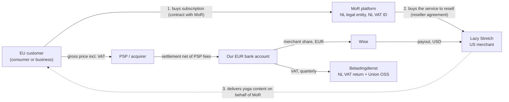

# MoR Context & Problem Framing

> Background notes from an earlier Merchant of Record system design exercise (an EU MoR for a US SaaS). Kept here as domain context for the ledger service. Related: [design-options.md](design-options.md).

## 1. The problem in one sentence

Build a platform that lets a non-EU SaaS (**Lazy Stretch**, US, yoga subscriptions) sell to EU customers **while we — a Dutch legal entity — are the legal seller**. We contract with the customer, charge them, collect and remit VAT, issue invoices, absorb refunds and chargebacks, and pay the merchant its share.

## 2. What "Merchant of Record" actually means

| Model | Legal seller to the customer | Owns VAT / sales tax | Liable for chargebacks | Examples |
|---|---|---|---|---|
| Payment gateway / PSP | Merchant | Merchant | Merchant | Adyen, Stripe Payments |
| Payment facilitator (PayFac) | Merchant (sub-merchant) | Merchant | Merchant (PayFac is first in line to the card scheme) | Stripe Connect, Square |
| **Merchant of Record (reseller)** | **Us** | **Us** | **Us** | Paddle, FastSpring, Lemon Squeezy, Digital River |

Design implications:

- The customer's **contract, T&Cs, card statement descriptor, invoice, privacy notice and billing support are ours**. The merchant is effectively our supplier.
- Anything that touches the end customer financially (price, renewal, cancellation, refund) must be **controlled or at least constrained by us**. This drives the "who owns the subscription" decision (see [design options, D1](design-options.md#d1-who-owns-the-subscription-lifecycle)).
- Our risk is the merchant's behaviour (refund abuse, disputes, fraud, bankruptcy with a negative balance). That means balance holds, reserves and monitoring.

## 3. Legal and money chain

## 4. Actors and systems

- **End customer**: an EU consumer, or occasionally a business with a VAT ID (corporate wellness).
- **Merchant (Lazy Stretch)** has a website, user accounts, a subscription/entitlement system and product support.
- **MoR platform (us)** provides checkout, billing, tax, invoicing, the ledger, payouts, and billing support. It also runs the finance and tax operations team.
- **External systems**:
  - PSP: acquiring, 3DS, tokenization, local payment methods, dispute notifications, settlement reports
  - Wise: FX and payouts
  - EUR bank account
  - Belastingdienst: NL VAT return and Union OSS return
  - VIES: EU VAT ID validation
  - ECB reference FX rates, for VAT reporting
  - IP geolocation and card BIN data
  - Email delivery
  - Sanctions list provider

## 5. Regulatory and business constraints that shape the design

### 5.1 VAT on digital services (the core "nice to have")

- **Place of supply.** For B2C electronically supplied services, and since 2025 also live-streamed or virtual services, the place of supply is the **customer's member state**. We charge that country's rate, which ranges from 17% (LU) to 27% (HU).
- **Union OSS.** We are EU-established (NL), so we register for Union OSS in NL. One quarterly return covers all other member states. It is due by the end of the month after the quarter ends. Supplies to NL customers go into the regular NL VAT return. **The merchant needs no EU VAT registration at all.** That is the value proposition.
- **Customer location evidence.** We need two pieces of evidence that don't contradict each other, e.g. billing address, IP geolocation, card BIN country, phone country code. We persist the evidence with every transaction.
- **B2B.** A valid VAT ID (checked in VIES) triggers reverse charge: 0% VAT plus the legal wording on the invoice. The exception is NL-to-NL B2B, which is charged 21% NL VAT.
- **Rates change several times a year.** Recent examples: FI 24% → 25.5% (2024), SK 20% → 23% (2025), EE 22% → 24% (2025). So we keep an effective-dated rate table and compute tax **per transaction, including every renewal**. Tax is never frozen on the subscription.
- **Retention.** OSS records must be kept for 10 years.
- **Future: ViDA** (digital reporting and e-invoicing, 2030+). Keep invoice data structured, not just as PDFs.
- **GST (nice to have).** The same abstraction extends to UK VAT, Norway VOEC, Australia GST and others: jurisdictions, registrations and rules.

### 5.2 Invoicing

- The invoice is issued **by us** (our name and NL VAT ID) to the customer.
- Mandatory fields (VAT Directive Art. 226): unique sequential number, date, seller and buyer details, description, net/VAT/gross per rate, VAT rate, reverse-charge wording for B2B, currency.
- Invoices are **immutable**. Corrections and refunds are issued as **credit notes** that reference the original invoice.
- **Numbering must be sequential with no gaps within a series.** This is a concurrency design point.
- Multi-currency invoices may need VAT amounts converted at the ECB rate. To verify with a tax advisor.
- Merchant side: a payout statement, and optionally a **self-billed invoice** for the merchant's supply to us (B2B, reverse-charged in NL).

### 5.3 Consumer protection (we are the seller)

- **14-day right of withdrawal** (Consumer Rights Directive). Checkout must collect explicit consent and acknowledgement to start the service immediately; otherwise we owe refunds.
- **Cancellation must be easy.** Germany requires an online "cancel contract" button (§312k BGB).
- **Price increases** for existing subscribers need advance notice or consent.
- **Seller identity must be clear** at checkout, on the card statement (e.g. descriptor `MOR*LAZYSTRETCH`) and on the invoice.

### 5.4 Payments

- **PSD2 SCA.** The first payment is customer-initiated (CIT) with 3DS. Renewals are merchant-initiated (MIT) and reference the initial transaction, which keeps them out of SCA scope.
- **Local payment methods** matter in the EU: iDEAL/Wero (NL), Bancontact (BE), BLIK (PL), SEPA Direct Debit. Only some of them support recurring payments.
- **Card-on-file hygiene.** Network tokens and account updater reduce involuntary churn.
- **Card-network exposure.** We are the merchant at the card-network level, so our dispute and fraud ratios are at stake (e.g. Visa VAMP). One bad merchant can hurt the whole platform.

### 5.5 Security and privacy

- **PCI DSS.** Use the PSP's hosted fields or drop-in, so no card number (PAN) ever reaches our systems (SAQ A-level scope) and the merchant has zero PCI scope.
- **GDPR.** We are a controller for billing data; the merchant is a controller for its user data. We need a data-sharing agreement and should minimise what we pass back.
  - Conflict: the right to erasure vs 10-year tax retention. Resolve by pseudonymising and keeping only tax-relevant fields.
- **Sanctions.** Screen customers and merchants against EU sanctions regimes.

### 5.6 Money and risk

- The PSP settles to us in EUR, T+N days, net of fees. We pay the merchant later, which means balances, holds, reserves and negative balances.
- **FX.** Customers may pay in EUR, PLN, SEK and others, but the merchant wants USD. Someone bears the FX risk; this is a decision to make.
- **Late disputes.** Chargebacks can arrive 120+ days after payment, so refund and dispute exposure continues after payout.

## 6. Requirements

### Functional

**Merchant-facing**
- Define products and prices (per currency, tax category, billing interval).
- Start a checkout for an EU customer and get the result.
- Subscription lifecycle: create, renew, upgrade/downgrade, pause, cancel, trials, discounts.
- Receive events (webhooks) to grant or revoke access.
- Initiate refunds and submit evidence for disputes.
- See balances, transactions, payouts and reports; receive payouts in USD.
- Use a sandbox environment.

**Customer-facing**
- Checkout with local payment methods and SCA, a transparent tax breakdown, and a B2B VAT ID field.
- Receipts and invoices by email.
- A billing portal: update payment method, cancel, download invoices.
- A billing support contact (that's us).

**Internal (finance / tax / ops)**
- VAT computation, OSS and NL returns, and an audit trail with the location evidence.
- Double-entry ledger; reconciliation against the PSP, bank and Wise.
- Payout runs with approvals, reserves and negative-balance recovery.
- Dispute management and per-merchant risk monitoring.

### Non-functional

- **Money correctness above everything:** no double charges, no lost payments, no double payouts. Achieved with idempotency and reconciliation.
- **Availability:** 99.95%+ for the checkout and renewal paths, with graceful degradation (e.g. when the tax data provider is down).
- **Auditability:** immutable records, 10-year retention.
- **Security:** minimal PCI scope, managed secrets, least privilege, tenant isolation.
- **Scalability:** horizontal scaling and burst handling. Renewal peaks, campaign peaks, and January "new year resolution" traffic for a yoga app.
- **Extensibility:** new merchants, jurisdictions (GST), payment methods and PSPs.

## 7. Back-of-envelope sizing

| Item | Estimate |
|---|---|
| Lazy Stretch alone | ~30k EU subscribers → ~1k renewals/day (trivial) |
| Platform target (assumption) | 2k merchants, 5M active subscriptions, ~6M payments/month |
| Average payment rate | ~200k/day ≈ 2–3 TPS |
| Peak | 50–100× average (campaigns, month-start renewal anchors) → low hundreds TPS |
| Ledger | ~5–8 postings per payment → ~50M rows/month → partition by time |
| Invoice PDFs | ~6M/month × ~50 KB ≈ 300 GB/month in object storage |

**Takeaway:** throughput is not the hard part. Correctness, compliance, idempotency and reconciliation are.

## 8. Assumptions (state up front)

- **Scope:** EU, mainly B2C. B2B is supported via VAT ID.
- **PSP:** a single PSP supporting cards, local methods, network tokens and 3DS.
- **Currencies:** our functional and settlement currency is EUR; the merchant is paid in USD via Wise.
- **Merchant readiness:** the merchant is already onboarded, KYC'd and underwritten (out of scope) and has an account and API keys.
- **Product:** the yoga product is a digital service (on-demand video, possibly live classes), taxed at the standard VAT rate of the customer's country.
- **Out of scope:** physical goods, import taxes and duties.

## 9. Open business questions

1. Does Lazy Stretch want to keep its subscription engine as the source of truth, or delegate billing for EU customers to us?
2. Only new EU customers, or should existing EU subscribers be migrated too?
3. What are the expected volumes? Is the platform ambition one merchant or thousands?
4. Pricing: local-currency price points (EUR/PLN/SEK…) or a single currency? Tax-inclusive?
5. Which payment methods are required beyond cards?
6. What payout frequency and currency does the merchant expect? Who bears FX?
7. Who handles customer billing support (L1/L2): us or the merchant?
8. Who owns the refund policy? Does the merchant decide and we execute? What are our limits?
9. Does our PSP contract support the MoR model (our MCC, a per-merchant dynamic descriptor)?
10. Any B2B requirements (corporate wellness, PO numbers on invoices)?

## 10. Glossary

| Term | Meaning |
|---|---|
| MoR | Merchant of Record: the legal seller to the end customer |
| OSS | One-Stop Shop: an EU scheme to declare cross-border B2C VAT in one member state |
| ESS | Electronically supplied services |
| VIES | EU VAT Information Exchange System (validates VAT IDs) |
| CIT / MIT | Customer-initiated / merchant-initiated transaction |
| SCA / 3DS | Strong Customer Authentication / 3-D Secure |
| BIN | Bank Identification Number, the first digits of a card; gives the issuing country |
| APM | Alternative (local) payment method |
| Reverse charge | The B2B buyer self-accounts for VAT; the seller charges 0% |
| Credit note | A document that negates or reduces a previously issued invoice |
| Self-billing | The buyer issues the invoice on behalf of the supplier (by agreement) |
| Rolling reserve | A % of merchant funds held for N days to cover refunds and disputes |
| Settlement | The PSP transfers collected funds (net of fees) to our bank |
| Payout | We transfer the merchant's share to the merchant |
| Reconciliation | Matching internal records against PSP, bank and Wise statements |
| Idempotency key | A client-supplied key so that retries don't duplicate side effects |
| Transactional outbox | Writing events in the same DB transaction as state, then publishing them asynchronously |
