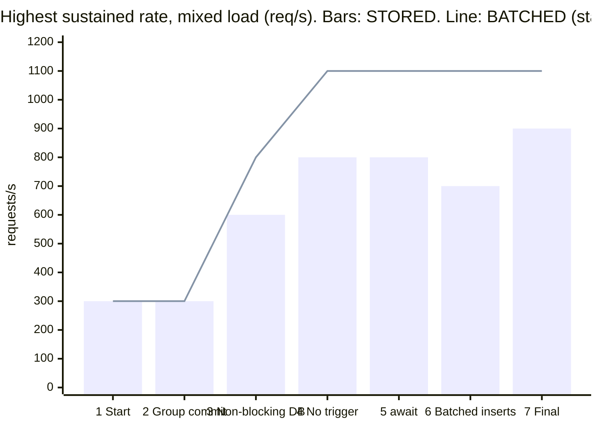

# Performance

On a budget of **2 CPUs and 3 GB** for the whole system (app 1 CPU, Postgres 1 CPU), the service sustains:
- **~1100 requests/s** with group commit (`BALANCE_MODE=BATCHED`);
- **600–900 requests/s** with the default one-transaction-per-request mode (`STORED`).

Both keep p95 latency at 3–4 ms at 300 requests/s, and both keep balances exact. We started at ~300 requests/s. The table and chart below show what each step changed.



The same chart, interactive and per scenario, is on the console's **Performance** page (`/ui/#/performance`).

## Results

Every stage was measured from its own commit, with the same harness, on the same machine (mains power, no other containers), in one run on 2026-10-17/18.
- **"Holds"** is the highest arrival rate held for 20 s with p95 < 250 ms and < 1% errors, at 100 rps resolution.
- **p95** and **CPU** are measured at a fixed 300 captures/s.
- **Ingest** is closed-loop bulk loading of 10k payments.

| Stage | Mode | Holds: capture / one merchant / mixed | p95 @300/s | CPU @300/s: app / Postgres (cores) | Ingest, payments/s |
|---|---|---|---|---|---|
| 1. Start | STORED | 200 / 300 / 300 | 30 ms | 0.11 / 0.53 | 326 |
| 2. Group commit | BATCHED | 300 / 300 / 300 | 92 ms | 0.13 / 0.52 | 296 |
| 3. Database work off the request threads | STORED | 500 / 400 / 600 | 4 ms | 0.13 / 0.28 | 469 |
| | BATCHED | 800 / 900 / 800 | 6 ms | 0.15 / 0.32 | 554 |
| 4. No balance trigger | STORED | 1000 / 700 / 800 | 4 ms | 0.12 / 0.21 | 708 |
| | BATCHED | 1100 / 1100 / 1100 | 4 ms | 0.13 / 0.25 | 927 |
| 5. `await` in the batch commit | BATCHED | 1100 / 1100 / 1100 | 4 ms | 0.13 / 0.22 | 943 |
| 6. Batched inserts | STORED | 700 / 700 / 700 | 4 ms | 0.12 / 0.21 | 731 |
| | BATCHED | 1100 / 1100 / 1100 | 5 ms | 0.12 / 0.21 | 970 |
| **7. Final** | **STORED** | **900 / 600 / 900** | **3 ms** | **0.13 / 0.21** | **706** |
| | **BATCHED** | **1000 / 1100 / 1100** | **4 ms** | **0.12 / 0.20** | **938** |
| | BATCHED, batches of 1000, 50 ms wait | 700 / 700 / 700 | 106 ms | 0.10 / 0.18 | 268 |

Not shown, because it does not change: the balance report takes 2–4 ms at 100k payments in both modes, and balances are exact in both. The books balanced and every merchant reconciled after every run.

## How we got here

**1. Six ways to keep a balance.** We compared them first; the definitions and numbers are in the [deep dive](#the-six-starting-methods).
- Two were ruled out on reads:
  - summing postings on every read: the report took 9 s at 100k payments;
  - a snapshot plus the tail since its last refresh: reads pay for the tail.
- Two had nothing to gain:
  - a snapshot read without the tail: up to 1 s stale, and writes no cheaper;
  - hot accounts split into sub-accounts.
- TigerBeetle (an external ledger) needed a dual write and most of the memory budget.

We kept **stored running balances**. They were exact, the simplest, and as fast as anything else. All six sat at 200–400 req/s for a reason found only in step 3.

**2. Group commit (`BATCHED`).** One writer thread runs queued requests in batches: one transaction, one commit and one balance update per account per batch, with a savepoint per request. On its own it changed nothing, because the cap from step 3 was still in place.

**3. Database work off Ktor's request threads.** Profiling (JFR plus `pg_stat_statements`) showed neither the app nor Postgres was busy.
- With a 1-CPU limit the JVM sees one core, so Ktor starts only 3 request threads.
- Every handler blocked on JDBC there, so no more than 3 requests were ever in flight.

Moving the database work to the IO dispatcher doubled `STORED` and almost tripled `BATCHED`.

**4. No deferred balance trigger.** The database re-checked each journal entry's balance once per inserted row: 5 times per capture, at commit. The check stays in code (`validatedPostings` via `LedgerWriter`). SQL statements per capture fell from 18 to 13, and both modes gained another 30–40%.

**5–7. Smaller steps** (detail in the deep dive):
- `await` instead of a blocking wait in the batch commit;
- batched inserts in the driver: 3 statements fewer per capture;
- the table-object refactor.

None moved the ceiling. Batches of 1000 with a 50 ms wait were worse: every request waits for its batch, so latency rises to ~100 ms and the latency limit is reached at 700 req/s. With no wait (the default) a batch grows by itself under load.

## Deep dive

### The six starting methods

Stage 1, commit `0ffcf3f`. Every method was capped near 300 req/s by the 3 request threads (step 3), so their write numbers are close. The differences that matter are on reads and in operations.

| Method | On a write | On a balance read | Freshness | Holds: capture / one merchant / mixed | Report p95 @100k payments |
|---|---|---|---|---|---|
| Stored balances | postings, plus `UPDATE balance` on each account | read the column | exact | 200 / 300 / 300 | 2 ms |
| Computed on read | postings only | `SUM` of all postings | exact | 300 / 300 / **100** | **9.1 s** |
| Snapshot + tail | postings only; snapshot refreshed every 1 s | snapshot + postings since the refresh | exact | 300 / 400 / 200 | 10 ms |
| Snapshot only | postings only; snapshot refreshed every 1 s | snapshot | up to 1 s stale (1004 ms max measured) | 400 / 200 / 300 | 3 ms |
| Sharded hot accounts | like stored, with clearing/fee/tax split into 8 sub-accounts | sum of the sub-accounts | exact | 300 / 400 / 400 | 2 ms |
| TigerBeetle | Postgres business row + TigerBeetle transfers (dual write) | `lookupAccounts` | exact | 200 / 300 / 200 | 28 ms |

- **Computed** fails on reads: with 5% balance reports in the mix it holds only 100 req/s.
- **Snapshot + tail** pays on every read: at 300 captures/s its p95 was 57 ms against 6–30 ms for the others.
- **Snapshot only** is cheap to read but stale, and it does not make writes cheaper.
- **Sharding** spreads row locks, but in stage 1 there was no lock contention to remove (3 requests in flight). By the final stage `STORED` does wait on locks (below); group commit removes those waits without changing the chart of accounts.
- **TigerBeetle** ran with app 0.8 CPU / 384 MB, Postgres 0.4 CPU / 256 MB and TigerBeetle 0.8 CPU / 2.4 GB, because it allocates ~2.3 GB at start-up.
  - p95 at 300 captures/s was 580 ms.
  - Every request writes Postgres (payment, idempotency) and then TigerBeetle.
  - Under this budget it cannot show what it is built for; see [ledger-comparison.md](ledger-comparison.md).

### Gain per step (mixed load, best mode)

| Step | Holds | Change | Ingest, BATCHED |
|---|---|---|---|
| 1 → 2 group commit | 300 → 300 | none (capped by the threads) | — |
| 2 → 3 database work off the request threads | 300 → 800 | **+167%** | 296 → 554 |
| 3 → 4 no trigger | 800 → 1100 | **+38%** | 554 → 927 |
| 4 → 5 `await` | 1100 → 1100 | — | 927 → 943 |
| 5 → 6 batched inserts | 1100 → 1100 | — | 943 → 970 |
| 6 → 7 refactor | 1100 → 1100 | — | 970 → 938 |

`STORED` over the same steps: 300 → 600 → 800 → 700 → 900.
- Its ceiling moves by ±200 between runs of the same code, because it saturates on row locks and the lock queue is erratic.
- `BATCHED` is stable within one 100 req/s step.

### Latency

- **At a fixed 300 captures/s**, p95 fell from 30 ms (stage 1, near its ceiling) to 3–4 ms from stage 3 on, in both modes.
- **At the ceiling** the two modes fail differently:
  - `STORED` stays fast until it falls off: its mixed p95 at the highest holding step was 7 ms;
  - `BATCHED` degrades gradually: 235 ms at 1100 req/s, as batches grow.
- **A batch wait costs latency directly.** With `BATCH_MAX_WAIT_MS=50`:
  - p95 at 300 captures/s was 106 ms;
  - closed-loop ingest fell to 268 payments/s, because each of the 24 loaders waits for its batch.

  Keep the wait at 0 unless batches need to be larger at low load.

### Where the load is

- **Neither container is CPU-bound below the ceiling.** At 300 captures/s the app used 0.12–0.13 cores and Postgres 0.20–0.21, out of 1.0 each. In stage 1 Postgres used 0.53, because 300/s was close to that stage's limit.
- **App CPU** (JFR, final stage):

  | Share | Where |
  |---|---|
  | ~40% | HTTP (Ktor / Netty) |
  | ~25% | our code |
  | ~15% | the JDBC driver and Hikari |
  | ~10% | coroutines |
  | ~8% | JSON |

- **What requests wait on in Postgres** (final stage):

  | | `STORED` | `BATCHED` |
  |---|---|---|
  | `commit` (the WAL flush) | 37% | 47% |
  | balance `UPDATE`s | 31% | 8% |
  | inserts | the rest | entry, postings and payment inserts, the rest |

- **What limits each mode at its ceiling:**
  - `STORED`: the hot accounts' row locks (`psp_clearing`, `fee_revenue`, `tax_payable`, and with one merchant also `merchant_payable`). At the one-merchant ceiling 39–80% of active Postgres backends wait on a lock.
  - `BATCHED`: 0% lock waits. One writer runs ~12 statements per request in sequence and commits once per batch, so the next lever would be grouping a batch's SQL into multi-row statements. That was estimated and not done: ~1100 req/s on 2 CPUs is far above this service's expected load.

### What we dropped

| Variant | Why dropped |
|---|---|
| Computed on read | reads grow with history |
| Snapshot + tail | reads pay the tail |
| Snapshot only | stale reads, writes no cheaper |
| Hot-account sharding | group commit removes the lock waits without changing the chart of accounts |
| TigerBeetle | dual write, and most of the memory budget |
| Batches of 10 | an earlier run: slower than `STORED`, because the single writer serialises work that the pool ran in parallel |
| A 50 ms batch wait | latency |

The code of the removed variants is at commit `0ffcf3f`.

## Setup

- **Budget:** 2 CPUs and 3 GB for the system under test, set with Docker limits ([`perf/compose.limits.yml`](../perf/compose.limits.yml)):
  - app 1.0 CPU / 1280 MB;
  - Postgres 1.0 CPU / 1792 MB (`shared_buffers` 448 MB).

  A limit is a CPU-time quota (cgroups), not pinned cores. The load generator runs outside the limit.
- **Host:** Docker Desktop 29.1.3 on Windows 11, a 16-CPU / 16 GB VM, a laptop on mains power ("Performance" power mode), no other containers. On battery the same code measured about half as fast, so all numbers here come from one mains-powered run.
- **Commits:** stage 1 `0ffcf3f`, 2 `80c90d9`, 3 `e5580cc`, 4 `8c524e2`, 5 `69cd154`, 6 `220572b`, 7 `96e5872`. Each ran in a git worktree with today's harness.

## Method

- **Load:** [k6](https://grafana.com/docs/k6/) 2.3.0 ([`perf/k6/bench.js`](../perf/k6/bench.js)) at a constant arrival rate (open loop), driven by [`perf/run-benchmarks.sh`](../perf/run-benchmarks.sh). Each variant starts from an empty database.
  - **Why k6 and not Kotlin?** k6 has a Go engine; only the scenarios are JavaScript. Its arrival-rate executor starts requests on schedule even when the service slows down, so latency is not hidden by coordinated omission. Gatling has a Kotlin DSL; a hand-written loop on coroutines would measure the wrong thing.
- **Warm-up and preload:** 15 s at 200 req/s, then 10k payments (the ingest number) and the balance report at 20 req/s. Stages 1 and 7 also load 100k payments and measure the report again.
- **Scenarios:**
  - `capture`: payments over 100 merchants, 3 currencies;
  - `hot`: every payment to one merchant in one jurisdiction;
  - `mixed`: 85% captures, 10% partial refunds, 5% balance reports.
- **Ladder:**
  - each scenario starts at 400 req/s and climbs by 200 while steps hold, then tries 100 below the first failing step;
  - if 400 fails, it steps down by 100;
  - a step lasts 20 s, and stops early once it clearly cannot hold (k6 thresholds with `abortOnFail`), followed by a 5 s cool-down;
  - a step **holds** if it served ≥ 95% of its planned requests with p95 < 250 ms and < 1% errors.
- **Profile at 300 captures/s:**
  - a 40 s step without a profiler gives CPU per container (`docker stats`) and SQL per capture (`pg_stat_statements`);
  - the app then restarts with JFR for a second step, used only for proportions ([`perf/analyse-jfr.sh`](../perf/analyse-jfr.sh)). JFR left on during the ladders cost a whole step.
- **Waits:** during every ladder step, `pg_stat_activity` is sampled every 200 ms. The result is the share of active backends waiting on a row lock or on IO.
- **Consistency:** after every variant, `/v1/ledger/verify` (stored balances against postings), the report's integrity check and per-merchant reconciliation must pass.

## Reproduce

```bash
perf/run-benchmarks.sh                                 # pg-stored, pg-batched-100, pg-batched-1000 (~45 min); perf/results/<time>/
perf/run-benchmarks.sh "pg-x:BALANCE_MODE=STORED"      # any settings as name:SETTING=value
```

Older stages run the same way from a worktree at their commit. Each run writes `summary.md` and `results.json`.
